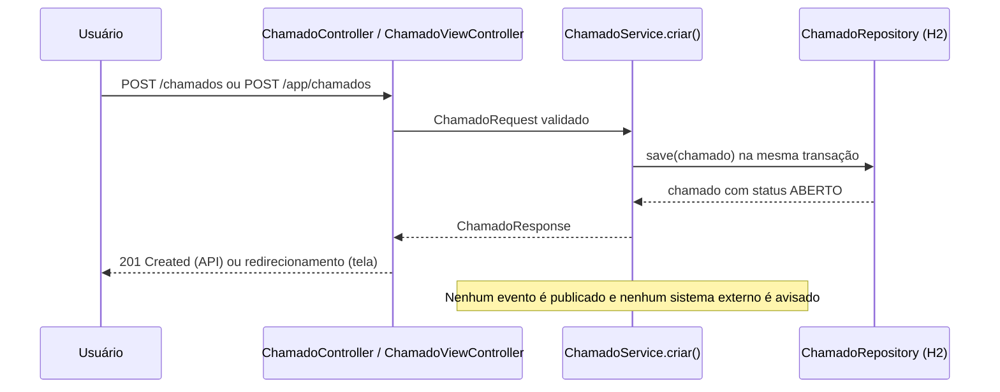

# Contexto: o Open Ticket antes da evolução

Desafio Final de DAS, Grupo 6 (Integrações, eventos, mensageria e proteção dos dados).
Este documento é a base da **seção 3 do relatório** ("Cenário e relação com o projeto"). Cada afirmação aponta para o trecho de código que a sustenta, para que possa ser conferida direto no repositório.

Versão analisada: `main` no commit `3c9d4a2`.

## Visão geral

O Open Ticket é um monólito em Java 21 com Spring Boot, organizado em camadas (pacote `com.openticket`). Ele tem duas portas de entrada para o mesmo `ChamadoService`:

| Entrada | Classe | Rota |
| --- | --- | --- |
| API REST | [`ChamadoController`](../src/main/java/com/openticket/controller/ChamadoController.java#L25) | `/chamados` |
| Telas Thymeleaf | [`ChamadoViewController`](../src/main/java/com/openticket/web/ChamadoViewController.java#L30) | `/app/chamados` |

Fonte: [`pom.xml`](../pom.xml#L30) (`java.version` 21).

## Fluxo de abertura de chamado

- A API recebe o pedido em [`ChamadoController.criar`](../src/main/java/com/openticket/controller/ChamadoController.java#L33-L35) e a tela em [`ChamadoViewController.criar`](../src/main/java/com/openticket/web/ChamadoViewController.java#L84-L92).
- [`ChamadoService.criar`](../src/main/java/com/openticket/service/ChamadoService.java#L57-L67) monta o chamado com cliente, categoria e técnico e chama `repository.save`. O método termina devolvendo o `ChamadoResponse`.
- O status inicial `ABERTO` e a data de abertura são definidos em [`Chamado.aoAbrir`](../src/main/java/com/openticket/entity/Chamado.java#L65-L68) (`@PrePersist`).

As outras mudanças passam pelo mesmo service, todas com `@Transactional` no método (não na classe):

| Mudança | Método |
| --- | --- |
| Comentar | [`comentar`](../src/main/java/com/openticket/service/ChamadoService.java#L87-L89) |
| Atualizar | [`atualizar`](../src/main/java/com/openticket/service/ChamadoService.java#L95-L97) |
| Atribuir técnico | [`atribuir`](../src/main/java/com/openticket/service/ChamadoService.java#L108-L110) |
| Alterar status | [`alterarStatus`](../src/main/java/com/openticket/service/ChamadoService.java#L116-L118) |

Ao fechar, o chamado recebe a data de fechamento ([L131-L132](../src/main/java/com/openticket/service/ChamadoService.java#L131-L132)) e passa a recusar alterações ([`buscarEntityAberto`](../src/main/java/com/openticket/service/ChamadoService.java#L151-L154)). Os status possíveis estão em [`StatusChamado`](../src/main/java/com/openticket/entity/StatusChamado.java#L4-L7).

**Conclusão:** o `ChamadoService` concentra todas as mudanças do chamado, então é o ponto natural para gerar os eventos propostos no trabalho.

## Relação das camadas com o tema

| Camada | Onde | O que importa para o trabalho |
| --- | --- | --- |
| Controller | `ChamadoController`, `ChamadoViewController` | O `POST /chamados` não tem chave de idempotência: uma requisição repetida cria outro chamado. |
| DTO | [`ClienteResponse`](../src/main/java/com/openticket/dto/ClienteResponse.java#L5), [`ChamadoResponse`](../src/main/java/com/openticket/dto/ChamadoResponse.java#L9-L20) | Devolvem nome, e-mail, telefone e a descrição completa. Eventos e integrações precisam de um DTO próprio e enxuto. |
| Service | `ChamadoService` | Lugar para gravar o evento no outbox, na mesma transação do chamado. |
| Repository | `ChamadoRepository` e demais | Faltariam repositórios para o outbox e para os eventos já processados. |
| Entity | `Chamado`, `Cliente`, `Tecnico`, `Comentario` | Concentram os dados pessoais (próxima seção). |

## Lacunas em relação aos objetivos

**Integrações e mensageria.** Não há webhooks, eventos publicados nem dependências de e-mail, fila ou mensageria no [`pom.xml`](../pom.xml#L32-L79). Uma ferramenta de Kanban teria de consultar `GET /chamados` repetidamente.

**Idempotência.** Não há chave de idempotência no `POST /chamados` nem restrição `unique` na entidade [`Chamado`](../src/main/java/com/openticket/entity/Chamado.java). Um duplo clique ou uma nova tentativa do cliente HTTP gera dois registros (evidência EV-01 do relatório).

**Dados pessoais (LGPD).**

| Entidade | Dados pessoais |
| --- | --- |
| [`Cliente`](../src/main/java/com/openticket/entity/Cliente.java#L14-L20) | nome, e-mail, telefone |
| [`Tecnico`](../src/main/java/com/openticket/entity/Tecnico.java#L14-L17) | nome, e-mail |
| [`Comentario`](../src/main/java/com/openticket/entity/Comentario.java#L15-L19) | autor e texto livre de até 2000 caracteres |
| [`Chamado`](../src/main/java/com/openticket/entity/Chamado.java#L20-L21) | descrição, texto livre de até 2000 caracteres |

Não há autenticação nos endpoints (nenhuma dependência de segurança no `pom.xml`) nem política de retenção ou eliminação de dados.

## Configurações relevantes

Fonte: [`application.properties`](../src/main/resources/application.properties).

| Configuração | Linha | Consequência |
| --- | --- | --- |
| `spring.datasource.url=jdbc:h2:mem:openticketdb` | [L3](../src/main/resources/application.properties#L3) | Banco em memória: os dados, inclusive uma futura tabela de outbox, somem a cada reinício. |
| `spring.datasource.username=sa` e senha vazia | [L5-L6](../src/main/resources/application.properties#L5-L6) | Console do banco sem senha. |
| `spring.h2.console.enabled=true` | [L11-L12](../src/main/resources/application.properties#L11-L12) | Console acessível em `/h2-console`. |
| `spring.jpa.show-sql=true` | [L9](../src/main/resources/application.properties#L9) | Consultas no log; os valores aparecem como `?`, então o risco de dados pessoais no log é baixo. |

A base atual (Web MVC, Data JPA, Validation e Thymeleaf) já oferece publicação de eventos do Spring e agendamento de tarefas, o suficiente para a demonstração sem novas dependências.

## Síntese

O ponto de partida é um sistema coeso e bem separado em camadas, mas fechado em si mesmo: tudo acontece dentro da requisição, sem integração externa, sem notificação e sem proteção específica de dados pessoais. As seções 4 a 7 do relatório usam este levantamento para o diagnóstico (D1 a D4), as propostas (P1 a P5) e o ADR-001.
